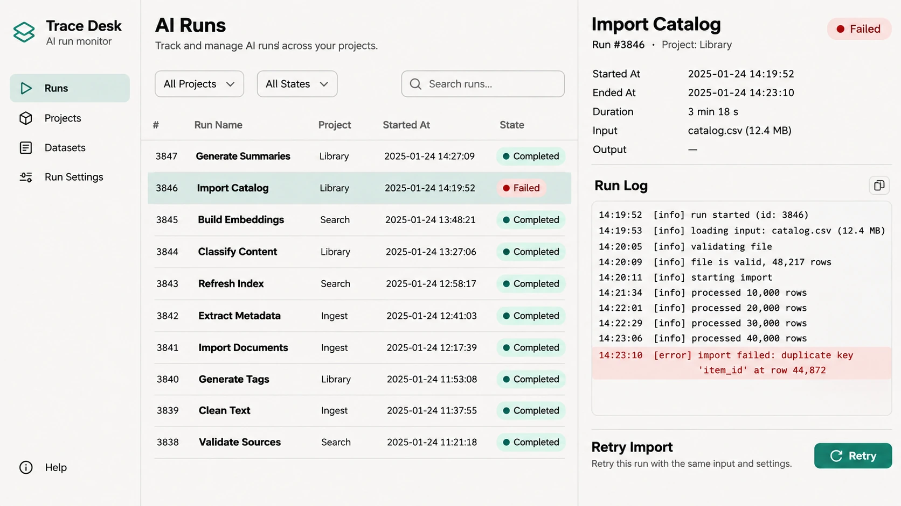
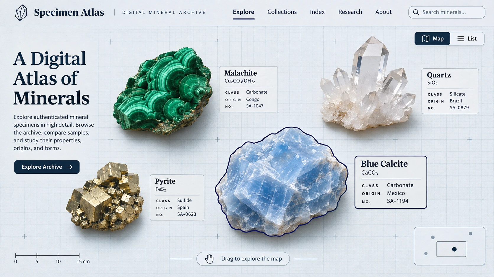
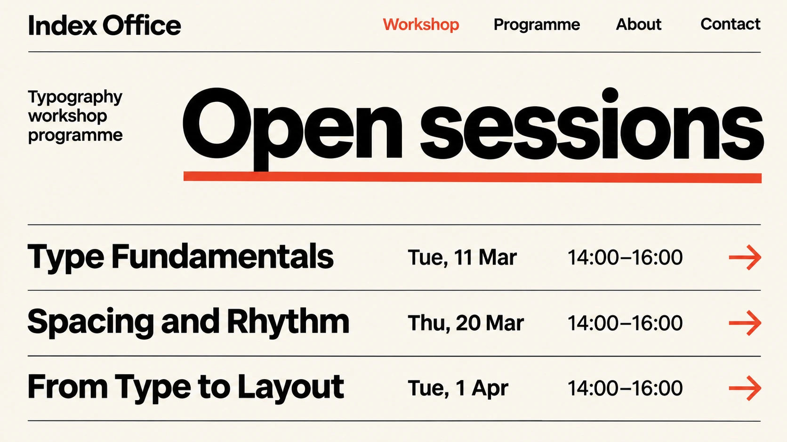
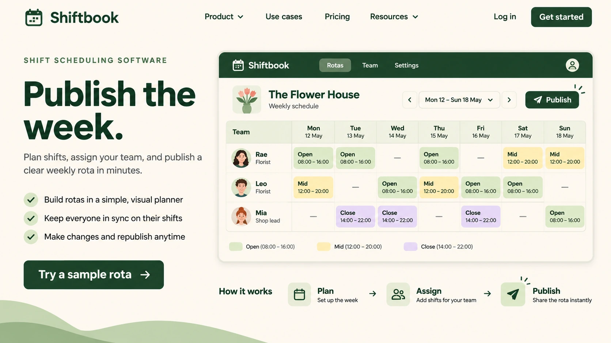

# Frontend Design Director

一个可安装的 Codex Skill，用于从零设计 Web 界面，或在保留现有业务流程的前提下改版。给它一个前端项目和一项用户任务，它会检查代码、选择视觉方向，把设计落实到可操作的页面，再验证这条任务路径。

[安装](#安装) · [调用示例](#调用示例) · [设计方向](#六种设计方向) · [工作流源文件](SKILL.md)

## Showcase

以下是六张原创设计方向示意图（illustrative mockups）。它们用虚构项目说明布局选择，均为静态配图；仓库内交付的是 Skill 指令与参考资料。点开图片可查看细节。

| Creative / Experimental · Phase Shift | Dashboard / Workspace · Trace Desk |
| --- | --- |
|  |  |
| 金属折带贯穿首屏，作品入口留在视觉动线的终点。 | 失败任务、错误行和重试按钮同屏，操作者可以边看日志边定位问题。 |

| Spatial Gallery · Specimen Atlas | Minimal / Swiss · Index Office |
| --- | --- |
|  |  |
| 矿物分布在可探索的地图上，列表入口照顾已知名称、只想查找标本的人。 | 日期和时间各自对齐，读者扫过一列就能比较场次。 |

| Premium / Editorial · Margin Review | SaaS / Product · Shiftbook |
| --- | --- |
|  |  |
| 庭院照片和图注建立空间感，章节索引让读者可以直接进入关心的部分。 | 访客先看懂一周班表，再决定是否试用排班工具。 |

[查看配图提示词与 Markdown](docs/showcase.md)

## 为什么做这个 Skill

同一个 AI 产品，官网访客要判断是否值得试用，工作台用户要找出刚刚失败的任务。两者如果都套用“大标题加一排卡片”，首页可能好看，操作者却仍得在几个页面之间来回找日志。

Frontend Design Director 要求 Codex 先说明谁在使用页面、要完成什么，再选择一种主导风格。改版时沿着真实路由走一遍关键流程；设计稿里的“重试”，最终要接回项目已有的状态和错误处理。

## 它如何工作

1. **读项目。** 检查技术栈、组件、路由和状态。新项目先梳理入口、任务、详情与恢复页面；已有项目先记录可运行的基线。
2. **选方向。** 根据用户任务、设备和内容密度选择主导风格，也可按你指定的方向实现。把选择落实到字阶、网格、间距和语义色。
3. **查参考。** 五类目录收录 38 个来源，涵盖设计奖项、网页案例、产品 UI、实际网站和实现技术。每次只加载相关分类，挑一两个案例，说明哪条原则能用在当前项目。访问状态和设计建议分别记录。[参考库入口](references/design-sources.md)
4. **完成一条业务流程。** 复用现有技术栈和组件，接入真实路由与数据，按需补齐加载、空、错误和完成状态。[交互模式](references/interaction-patterns.md)
5. **检查并修复。** 运行项目已有检查。有浏览器时验证桌面、窄屏、键盘、返回和减弱动态；没有浏览器时列出待人工验证的步骤。[验收清单](references/quality-checklist.md)

## 六种设计方向

| 方向 | 适用场景与判断依据 |
| --- | --- |
| Creative / Experimental | 工作室或活动官网需要一个有辨识度的主场景，同时让访客能直接进入作品或联系页面。 |
| Premium / Editorial | 长篇故事、品牌专题或精品产品适合用图像、标题和窄栏正文控制阅读节奏。 |
| SaaS / Product | 产品官网需要把功能介绍接到一次可理解的试用、注册或上手流程。 |
| Dashboard / Workspace | 监控和操作任务需要同时比较列表、选中项和活动记录，小屏适合逐层查看。 |
| Spatial Gallery | 作品或藏品之间的位置关系有助于探索，同时需要可搜索的索引与详情深链。 |
| Minimal / Swiss | 日程、目录和结构化集合依靠网格、字重与对齐，让人快速扫读和比较。 |

## 安装

**Windows 11 · Git + Codex。** 在准备存放 Skill 的父目录打开 PowerShell。已有本地仓库时直接进入其根目录，跳过克隆。

```powershell
git clone https://github.com/gaoyuan513/frontend-design-director.git
cd frontend-design-director
```

在仓库根目录创建用户级目录联接。这样各个项目共用同一份 Skill，之后在这份仓库中运行 `git pull --ff-only` 即可更新。

```powershell
$src = (Resolve-Path .).Path
if (!(Test-Path -LiteralPath (Join-Path $src 'SKILL.md'))) { throw '请先进入 Skill 仓库根目录' }
$root = Join-Path $HOME '.agents/skills'
New-Item -ItemType Directory -Path $root -Force | Out-Null
$dest = Join-Path $root 'frontend-design-director'
if (Test-Path -LiteralPath $dest) { throw "同名安装已存在：$dest" }
New-Item -ItemType Junction -Path $dest -Target $src
Test-Path -LiteralPath (Join-Path $dest 'SKILL.md')
```

最后一行应返回 `True`。保留本地仓库，在要开发的 **Web 项目** 中打开新的 Codex 会话并输入下面任一提示词。如果 Skill 未出现，重启 Codex 后再试。私有仓库需要具有访问权限的 GitHub 账号才能克隆。

## 调用示例

**产品官网 · 从零开发**

```text
$frontend-design-director 为排班工具设计产品官网。访客需要先理解怎样发布一周班表，再决定是否试用。先确定信息架构，再实现从功能示例到试用入口的移动端和桌面端布局。
```

**AI Agent · 改造已有工作台**

```text
$frontend-design-director 改版当前 Agent 的运行页面。沿现有 API 追踪一次失败和重试，让用户同时看到所选任务、错误日志和下一步操作。验证刷新后的选中项，以及手机上从详情返回列表的行为。
```

**作品集 · 空间画廊**

```text
$frontend-design-director 将现有作品集改为空间画廊。保留详情 URL 和搜索入口，区分点击与拖拽。用键盘和触控分别打开一件作品，返回时检查画布位置。
```

**编辑设计 · 品牌专题**

```text
$frontend-design-director 用 Premium / Editorial 方向实现一期双语建筑专题。根据已有摄影、图注与访谈排版；用最长的中英文标题检查手机断行，确保章节链接可分享。
```

## 仓库结构

| 位置 | 内容 |
| --- | --- |
| [SKILL.md](SKILL.md) | 触发条件、项目分析与实施步骤，供 Codex 在调用时读取。 |
| [references/](references/) | 模式选择、来源索引、交互建议和浏览器验收清单，按任务加载。 |
| [assets/](assets/) | 可适配到项目主题的 [Token 示例](assets/design-tokens.example.json) 及 README 配图。 |
| [agents/openai.yaml](agents/openai.yaml) | Codex 界面使用的名称和简短描述。 |

## Roadmap

后续优先补充跨页面流程案例，涵盖从列表进入详情、操作失败后恢复、返回并保留筛选条件。参考库也会逐步补充具体页面的观察记录和交互验收方法。

## Contributing

欢迎通过 [Issue](https://github.com/gaoyuan513/frontend-design-director/issues) 分享一次使用经历。请附项目类型、提示词、预期行为和实际结果。提交设计参考 PR 时，请写明页面地址、可观察到的细节，以及它会改变哪项布局或交互决策。

## License

仓库目前尚未指定开源许可证。

## English

Frontend Design Director is an installable Codex skill for building web interfaces and redesigning existing products. It picks a visual direction from the user's task, implements a complete flow in the existing stack, and checks the result in a browser when available. Install it once, then invoke `$frontend-design-director` from your web project.
