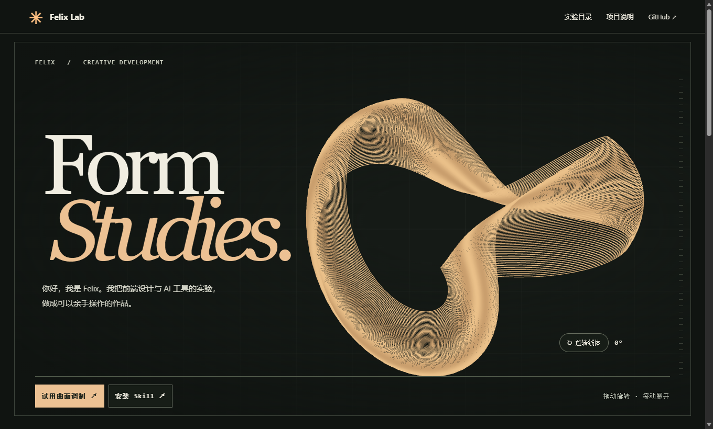
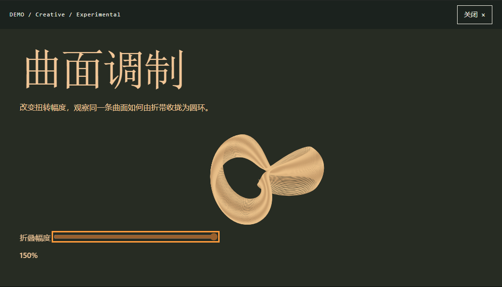
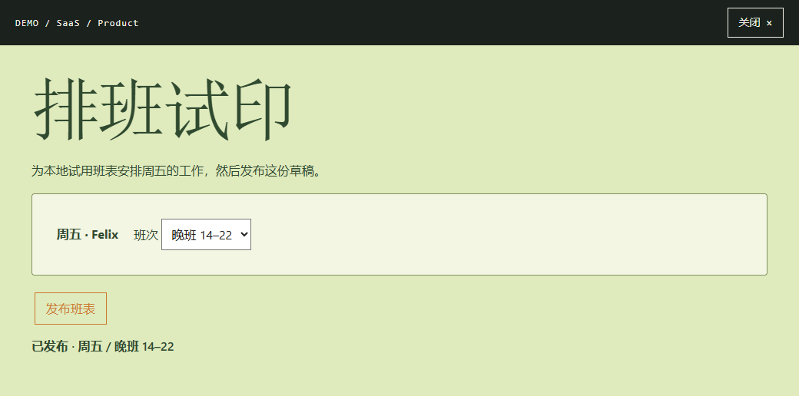

# Frontend Design Director

让 Codex 在真实项目里完成前端设计、实现和浏览器验收。可以从一张设计稿、一段出错的交互，或一个还没有视觉方向的想法开始。

**[打开交互演示](https://gaoyuan513.github.io/frontend-design-director/)** · [安装](#quick-start) · [调用示例](#调用示例) · [浏览器实测](docs/acceptance.md) · [English](#english)

[](https://gaoyuan513.github.io/frontend-design-director/)

## Quick start

**Windows · Git + Codex。** 在准备存放 Skill 的父目录打开 PowerShell。已有本地仓库时，直接在仓库根目录执行第二段。

```powershell
git clone https://github.com/gaoyuan513/frontend-design-director.git
cd frontend-design-director
```

```powershell
$skillSource = (Resolve-Path .).Path
if (!(Test-Path -LiteralPath (Join-Path $skillSource 'SKILL.md'))) { throw '请先进入 Skill 仓库根目录' }
$skillRoot = Join-Path $env:USERPROFILE '.agents/skills'
New-Item -ItemType Directory -Path $skillRoot -Force | Out-Null
$skillTarget = Join-Path $skillRoot 'frontend-design-director'
if (Test-Path -LiteralPath $skillTarget) { throw "同名 Skill 已存在：$skillTarget" }
New-Item -ItemType Junction -Path $skillTarget -Target $skillSource | Out-Null
Test-Path -LiteralPath (Join-Path $skillTarget 'SKILL.md')
```

看到 `True` 后，在要开发的 Web 项目里打开新的 Codex 会话，试一条下面的提示词。目录联接指向本地仓库，之后在仓库内运行 `git pull --ff-only` 即可获取更新。

## 一条可以亲手验证的路径

### 事件回放 · 从失败运行到重试完成

> 改版 Agent 运行页。让用户看清失败原因、保留所选任务，并能从日志发起重试。在窄屏上检查操作反馈和返回后的焦点。

这个场景用列表保留运行上下文，在详情里显示失败原因和下一步。打开演示，选择「导入索引」，点「重试导入」，观察日志和任务状态如何更新。退出详情时检查焦点是否回到可以继续操作的位置。

[](https://gaoyuan513.github.io/frontend-design-director/#demo-workspace)

[试运行事件回放](https://gaoyuan513.github.io/frontend-design-director/#demo-workspace) · [产品流程指南](references/product-interfaces.md) · [实测记录](docs/acceptance.md)

## Form Studies · 六个可操作实验

首屏可以拖动线体、按按钮旋转或随滚动展开。实验索引里的每项都有可分享的详情链接。排班和运行日志使用本地示例数据。

| 实验 | 可以验证的交互 |
| --- | --- |
| [曲面调制](https://gaoyuan513.github.io/frontend-design-director/#demo-creative) | 调整幅度，观察曲面折叠程度随输入变化 |
| [光影手记](https://gaoyuan513.github.io/frontend-design-director/#demo-editorial) | 切换章节，观察取景位置和正文同步改变 |
| [排班试印](https://gaoyuan513.github.io/frontend-design-director/#demo-product) | 修改周五班次并发布草稿 |
| [事件回放](https://gaoyuan513.github.io/frontend-design-director/#demo-workspace) | 查看失败事件，重试并观察完成状态 |
| [空间标本](https://gaoyuan513.github.io/frontend-design-director/#demo-gallery) | 拖画布探索，或按标本名称定位 |
| [场次索引](https://gaoyuan513.github.io/frontend-design-director/#demo-swiss) | 切换排序依据，比较课程名和时间 |

[桌面与手机录屏](https://gaoyuan513.github.io/frontend-design-director/reel/) · [六种界面截图](#实验截图) · [静态源码](docs/demo/)

### 实验截图

<details>
<summary>展开六种设计方向的浏览器实拍</summary>

| Creative / Experimental | Premium / Editorial |
| --- | --- |
| [](https://gaoyuan513.github.io/frontend-design-director/#demo-creative) | [](https://gaoyuan513.github.io/frontend-design-director/#demo-editorial) |

| SaaS / Product | Dashboard / Workspace |
| --- | --- |
| [](https://gaoyuan513.github.io/frontend-design-director/#demo-product) | [](https://gaoyuan513.github.io/frontend-design-director/#demo-workspace) |

| Spatial Gallery | Minimal / Swiss |
| --- | --- |
| [](https://gaoyuan513.github.io/frontend-design-director/#demo-gallery) | [](https://gaoyuan513.github.io/frontend-design-director/#demo-swiss) |

</details>

## Skill 怎样工作

1. **定位任务。** 找到真实入口、数据和已有组件。局部修复先复现，按设计稿实现先确认参考的视口和状态。[实施入口](SKILL.md) · [前端实现指南](references/implementation.md)
2. **确定设计决策。** 有视觉空间时，把主操作、内容、版式、字体和色彩落到一个具体方案。产品改版先梳理失败恢复。创意页面先让关键输入产生可见反馈。[设计方向](references/design-styles.md) · [创意指导](references/creative-direction.md)
3. **完成并验收。** 用真实内容走主路径，按任务检查相邻断点、键盘、触控或失败状态。记录观察结果和验证范围。[浏览器验收指南](references/quality-checklist.md)

设计决策的组织方式参考了 UI UX Pro Max 从场景推导设计系统的做法。展示借鉴了它用单一 brief 串起设计与运行结果的方式，以及 Taste Skill 和 Impeccable 用具体界面变化呈现结果的做法。[UI UX Pro Max](https://github.com/nextlevelbuilder/ui-ux-pro-max-skill) · [Taste Skill](https://www.tasteskill.dev/) · [Impeccable Gallery](https://impeccable.style/gallery/)

## 调用示例

**局部修复**

```text
$frontend-design-director 修复 390px 下订单筛选弹层标题被裁切的问题。复用现有 Dialog，验证键盘关闭与焦点恢复。
```

**按设计稿实现**

```text
$frontend-design-director 用现有组件实现这份桌面稿。保持图文层级与主操作，按阅读顺序重排窄屏布局，并注明从设计稿推导的状态。
```

**沉浸式作品集**

```text
$frontend-design-director 为声音采集作品集设计一个可以操纵的视觉对象，用滚动连接地点与录音详情。验证触控、键盘和减弱动态路径。音频由访客主动播放。
```

## 开发和资料

从仓库根目录运行 `python -m http.server 8000 --directory docs/demo`，然后打开 [本地预览](http://127.0.0.1:8000/)。

- [参考资料](references/) 按任务加载设计、实现和验收方法。
- [主题示例](assets/design-tokens.example.json) 提供可适配的设计令牌。
- [展示素材说明](docs/showcase.md) 记录六个静态设计方向的图像生成提示词。
- [Issues](https://github.com/gaoyuan513/frontend-design-director/issues) 接收使用反馈。附项目类型、提示词、预期行为与实际结果，便于复现。

仓库目前尚未指定开源许可证。

## English

Frontend Design Director is a Codex skill for targeted UI fixes, reference-led builds, responsive product flows, and interactive websites. Try the [live experiments](https://gaoyuan513.github.io/frontend-design-director/), follow the [Windows quick start](#quick-start), then invoke the skill in a web project with `$frontend-design-director`.
