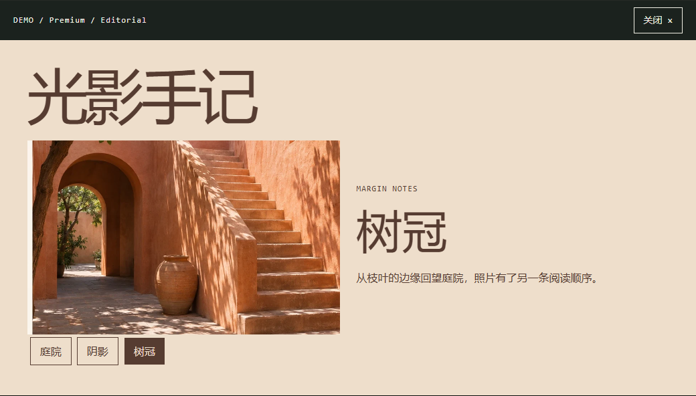
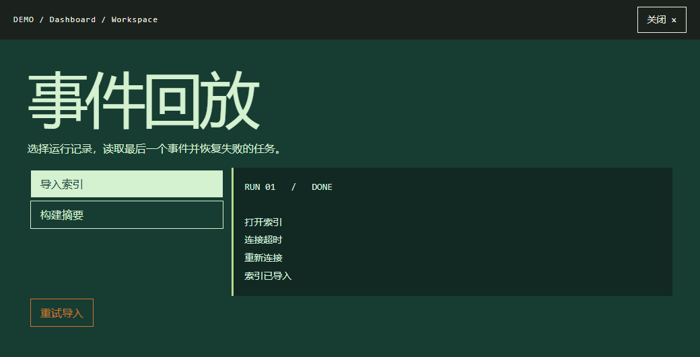
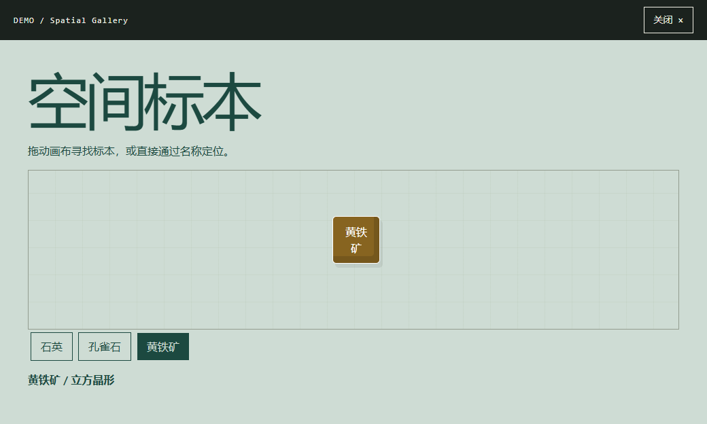
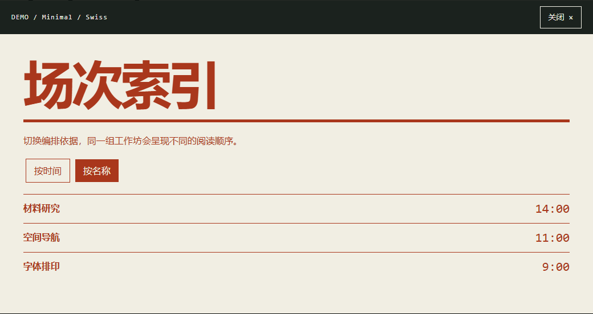

# Frontend Design Director v2

一个用于 Web 前端设计与实现的 Codex Skill。面对创意项目，它先比较三种视觉概念，再用真实输入验证其中一种；面对已有产品，它沿着现有路由和业务状态完成增量改版。

[](https://gaoyuan513.github.io/frontend-design-director/)

**[进入 Live Demo ↗](https://gaoyuan513.github.io/frontend-design-director/)** · [安装](#安装) · [调用示例](#调用示例) · [实测记录](docs/acceptance.md)

## Form Studies / 现场实验

拖动线体改变观察角度；向下滚动，线束沿深度方向展开。到达实验索引后，横拖选择一个方向，进入详情并亲手改变其状态。

[播放桌面与手机录屏](https://gaoyuan513.github.io/frontend-design-director/reel/) · [桌面 MP4](docs/demo/reel/form-studies-desktop.mp4) · [手机 MP4](docs/demo/reel/form-studies-mobile.mp4) · [动图预览](docs/evidence/field-session.gif) · [静态源码](docs/demo/)

以下图片全部来自运行中的浏览器。每个 Demo 只实现表中描述的一段交互；排班和运行日志使用本地示例数据。

| Creative / Experimental · 曲面调制 | Premium / Editorial · 光影手记 |
| --- | --- |
| [](https://gaoyuan513.github.io/frontend-design-director/#demo-creative) | [](https://gaoyuan513.github.io/frontend-design-director/#demo-editorial) |
| 调整幅度，改变曲面的折叠程度。 | 选择章节，改变取景位置与阅读内容。 |

| SaaS / Product · 排班试印 | Dashboard / Workspace · 事件回放 |
| --- | --- |
| [](https://gaoyuan513.github.io/frontend-design-director/#demo-product) | [](https://gaoyuan513.github.io/frontend-design-director/#demo-workspace) |
| 修改周五班次，再发布草稿。 | 查看失败事件，重试并观察完成状态。 |

| Spatial Gallery · 空间标本 | Minimal / Swiss · 场次索引 |
| --- | --- |
| [](https://gaoyuan513.github.io/frontend-design-director/#demo-gallery) | [](https://gaoyuan513.github.io/frontend-design-director/#demo-swiss) |
| 拖动画布寻找标本，也可通过名称定位。 | 改变排序依据，比较课程名和时间。 |

## 创意项目怎样进入实现

1. 在写界面之前，比较三种概念的隐喻、主视觉对象、构图、输入、状态变化和实现成本。选定一种，说明它为什么适合这项任务。
2. 从实际参考作品提炼一条原则，标明亲手操作、奖项资料与实现推测之间的区别。[案例笔记](references/award-winning-case-studies.md)
3. 先做最难的输入原型；为滚动、文字进入和场景退出写明触发、变化、持续与中断。依内容需要选择 CSS、Canvas 或 GPU。[艺术与动效指导](references/creative-direction.md)
4. 在真实浏览器中完成一次进入、操作、返回的路径。验证触控、键盘、减弱动态与活动帧耗时。[Creative Quality Gate](references/quality-checklist.md)


## 六种设计方向

| 方向 | 适用场景与判断依据 |
| --- | --- |
| Creative / Experimental | 工作室或活动官网需要一个有辨识度的主场景，同时让访客能直接进入作品或联系页面。 |
| Premium / Editorial | 长篇故事、品牌专题或精品产品适合用图像、标题和窄栏正文控制阅读节奏。 |
| SaaS / Product | 产品官网需要把功能介绍接到一次可理解的试用、注册或上手流程。 |
| Dashboard / Workspace | 监控和操作任务需要同时比较列表、选中项和活动记录，小屏适合逐层查看。 |
| Spatial Gallery | 作品或藏品之间的位置关系有助于探索，同时需要可搜索的索引与详情深链。 |
| Minimal / Swiss | 日程、目录和结构化集合依靠网格、字重与对齐，让人快速扫读和比较。 |

## 安装

**Windows 11 · Git + Codex。** 在准备存放 Skill 的父目录打开 PowerShell。已有本地仓库时直接进入其根目录，跳过克隆。

```powershell
git clone https://github.com/gaoyuan513/frontend-design-director.git
cd frontend-design-director
```

在仓库根目录创建用户级目录联接。这样各个项目共用同一份 Skill，之后在这份仓库中运行 `git pull --ff-only` 即可更新。

```powershell
$src = (Resolve-Path .).Path
if (!(Test-Path -LiteralPath (Join-Path $src 'SKILL.md'))) { throw '请先进入 Skill 仓库根目录' }
$root = Join-Path $HOME '.agents/skills'
New-Item -ItemType Directory -Path $root -Force | Out-Null
$dest = Join-Path $root 'frontend-design-director'
if (Test-Path -LiteralPath $dest) { throw "同名安装已存在：$dest" }
New-Item -ItemType Junction -Path $dest -Target $src
Test-Path -LiteralPath (Join-Path $dest 'SKILL.md')
```

最后一行应返回 `True`。保留本地仓库，在要开发的 **Web 项目** 中打开新的 Codex 会话并输入下面任一提示词。如果 Skill 未出现，重启 Codex 后再试。

## 调用示例

**创意作品集 · 从概念到浏览器**

```text
$frontend-design-director 为我的声音采集作品集设计一个可操纵的视觉对象。比较三种概念后实现一种，用滚动连接地点与录音详情；给出触控、键盘与减弱动态路径，用浏览器验证输入确实改变场景。音频由用户主动播放。
```

**产品官网 · 从零开发**

```text
$frontend-design-director 为排班工具设计产品官网。访客需要先理解怎样发布一周班表，再决定是否试用。先确定信息架构，再实现从功能示例到试用入口的移动端和桌面端布局。
```

**AI Agent · 改造已有工作台**

```text
$frontend-design-director 改版当前 Agent 的运行页面。沿现有 API 追踪一次失败和重试，让用户同时看到所选任务、错误日志和下一步操作。验证刷新后的选中项，以及手机上从详情返回列表的行为。
```

**作品集 · 空间画廊**

```text
$frontend-design-director 将现有作品集改为空间画廊。保留详情 URL 和搜索入口，区分点击与拖拽。用键盘和触控分别打开一件作品，返回时检查画布位置。
```

**编辑设计 · 品牌专题**

```text
$frontend-design-director 用 Premium / Editorial 方向实现一期双语建筑专题。根据已有摄影、图注与访谈排版；用最长的中英文标题检查手机断行，确保章节链接可分享。
```

## 仓库结构

| 位置 | 内容 |
| --- | --- |
| [SKILL.md](SKILL.md) | 触发条件、项目分析与实施步骤，供 Codex 在调用时读取。 |
| [references/](references/) | 模式选择、来源索引、交互建议和浏览器验收清单，按任务加载。 |
| [assets/](assets/) | 可适配到项目主题的 [Token 示例](assets/design-tokens.example.json) 与早期静态概念图。 |
| [agents/openai.yaml](agents/openai.yaml) | Codex 界面使用的名称和简短描述。 |
| [docs/demo/](docs/demo/) | 可直接部署的静态实验站与独立录屏播放页。 |
| [docs/evidence/](docs/evidence/) | 浏览器截图与动图。 |

从仓库根目录运行 `python -m http.server 8000 --directory docs/demo`，在浏览器打开 [本地预览](http://127.0.0.1:8000/)。

## Roadmap

后续优先补充跨页面流程案例，涵盖从列表进入详情、操作失败后恢复、返回并保留筛选条件。参考库也会逐步补充具体页面的观察记录和交互验收方法。

## Contributing

欢迎通过 [Issue](https://github.com/gaoyuan513/frontend-design-director/issues) 分享一次使用经历。请附项目类型、提示词、预期行为和实际结果。提交设计参考 PR 时，请写明页面地址、可观察到的细节，以及它会改变哪项布局或交互决策。

## License

仓库目前尚未指定开源许可证。

## English

Frontend Design Director is an installable Codex skill for building web interfaces and redesigning existing products. It picks a visual direction from the user's task, implements a complete flow in the existing stack, and checks the result in a browser when available. Install it once, then invoke `$frontend-design-director` from your web project.
