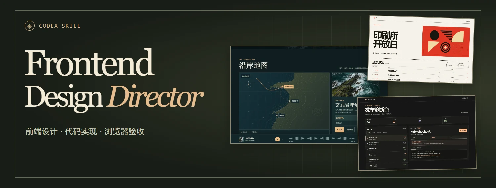
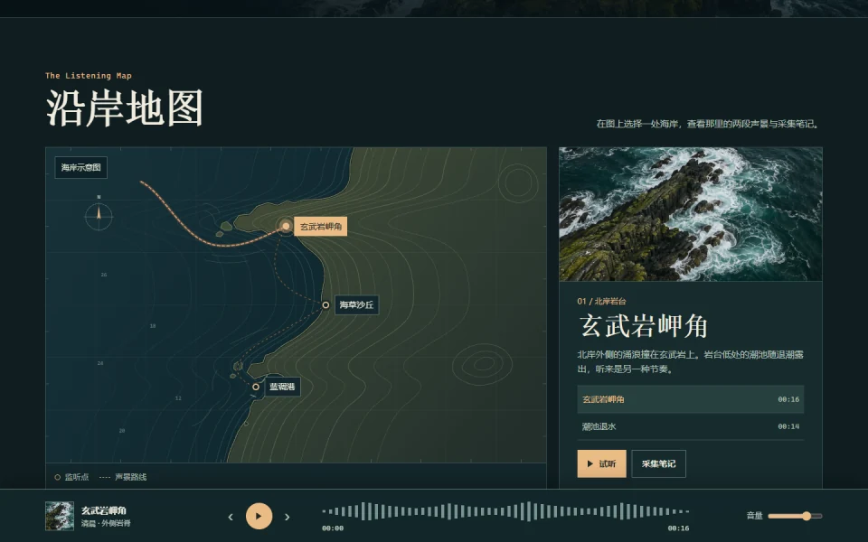
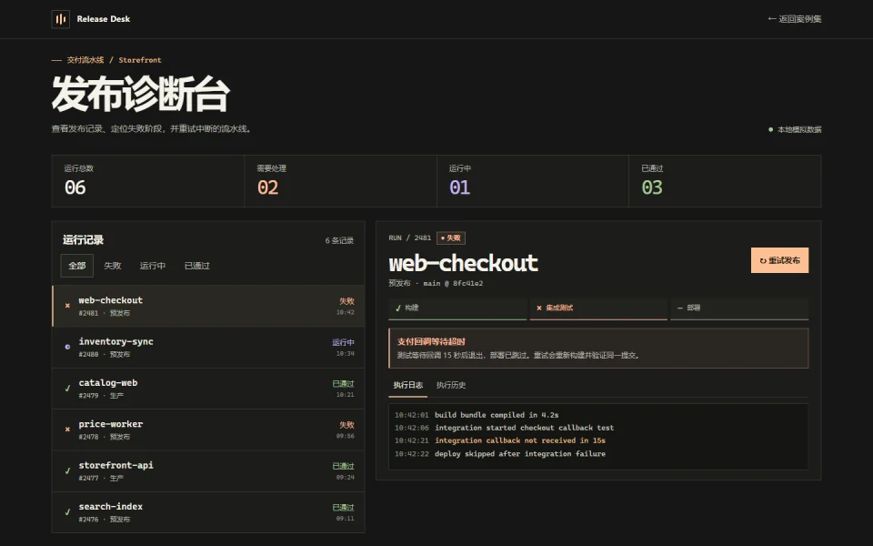
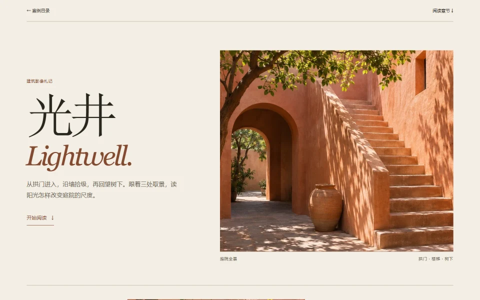
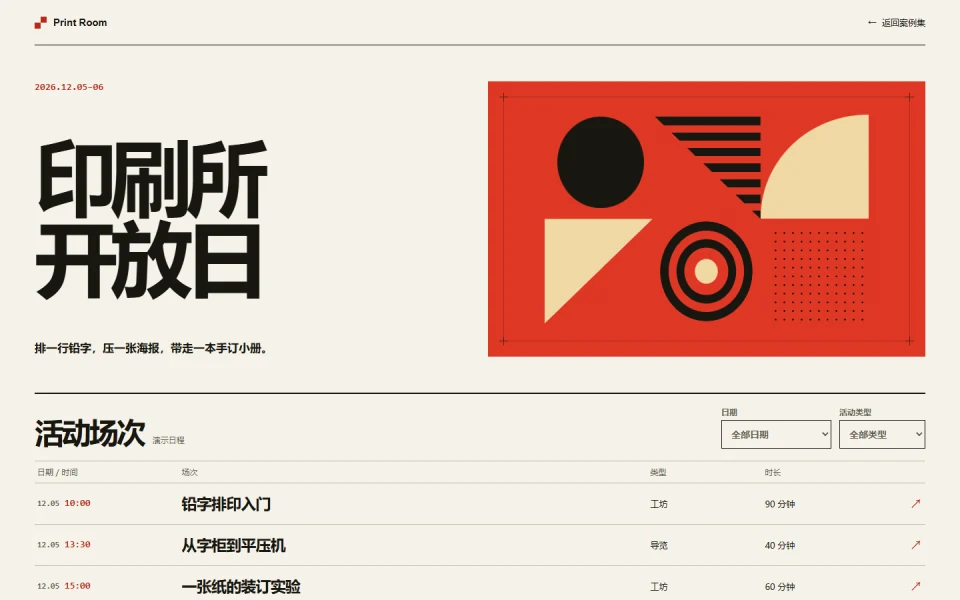

[](https://gaoyuan513.github.io/frontend-design-director/cases/)

<p align="center">
  <strong><a href="https://gaoyuan513.github.io/frontend-design-director/cases/">浏览在线案例</a></strong>
  · <a href="#quick-start">安装与调用</a>
  · <a href="#skill-怎样工作">工作流程</a>
  · <a href="https://github.com/gaoyuan513/frontend-design-director/blob/main/docs/acceptance.md">浏览器实测</a>
  · <a href="#english">English</a>
</p>

**Frontend Design Director** 是一个把前端设计、代码实现和浏览器验收连起来的 Codex Skill。有设计稿时按已有视觉和组件落地。从零开始时先明确访客要做什么，再决定版式、素材和交互。修现有页面时从出问题的路径开始。

## 按任务看案例

这四个页面可以直接操作。点图打开对应案例，按下面的步骤观察界面变化。

| 创意导航 | 产品工作台 |
| --- | --- |
| [](https://gaoyuan513.github.io/frontend-design-director/cases/coast-atlas/) | [](https://gaoyuan513.github.io/frontend-design-director/cases/release-desk/) |
| **沿岸声志 · Coastal Sound Atlas**<br>图上的位置决定当前场景和音频。点夜港，试听声景、跳转波形或收藏。<br>[在线操作](https://gaoyuan513.github.io/frontend-design-director/cases/coast-atlas/) · [源码](docs/demo/cases/coast-atlas/index.html) | **发布诊断台 · Release Desk**<br>失败原因、日志和恢复入口在同一工作区。筛选失败任务，重试并观察状态变化。<br>[在线操作](https://gaoyuan513.github.io/frontend-design-director/cases/release-desk/) · [源码](docs/demo/cases/release-desk/index.html) |

| 编辑专题 | 活动索引 |
| --- | --- |
| [](https://gaoyuan513.github.io/frontend-design-director/cases/lightwell/) | [](https://gaoyuan513.github.io/frontend-design-director/cases/print-room/) |
| **光井 · Lightwell**<br>同一张摄影用不同取景展示院落的空间线索。切换章节，再用章节链接打开同一视角。<br>[在线操作](https://gaoyuan513.github.io/frontend-design-director/cases/lightwell/) · [源码](docs/demo/cases/lightwell/index.html) | **印刷所开放日 · Print Room**<br>日期和印刷工艺能组合筛选。打开一场活动，查看详情和可下载的准备清单。<br>[在线操作](https://gaoyuan513.github.io/frontend-design-director/cases/print-room/) · [源码](docs/demo/cases/print-room/index.html) |

案例中的运行记录、活动和声景均为示例内容。图片来自运行中的浏览器。各案例的复现步骤与验证范围见[实测记录](docs/acceptance.md)。

### 从一句需求到可验收的页面

以「发布诊断台」为例，给 Codex 一条可以一起完成和验证的任务。

```text
$frontend-design-director 为发布运行页做一个诊断工作台。用户需要筛出失败发布，
读到失败原因，再重试并看到结果。在桌面同时保留列表和详情，核对手机布局。
请用浏览器走完失败、重试中、完成的状态变化。
```

设计先确定列表、选中项、恢复操作之间的联系。实现时要保留可操作的失败态和等待反馈。交付时运行同一条流程，检查变化出现在正确的任务上。[试运行发布诊断台](https://gaoyuan513.github.io/frontend-design-director/cases/release-desk/) · [产品流程指南](references/product-interfaces.md)

## Quick start

**Windows · Git + Codex。** 在准备存放 Skill 的父目录打开 PowerShell。已有本地仓库时，直接在仓库根目录执行第二段。

```powershell
git clone https://github.com/gaoyuan513/frontend-design-director.git
cd frontend-design-director
```

```powershell
$skillSource = (Resolve-Path .).Path
if (!(Test-Path -LiteralPath (Join-Path $skillSource 'SKILL.md'))) { throw '请先进入 Skill 仓库根目录' }
$skillRoot = Join-Path $env:USERPROFILE '.agents/skills'
New-Item -ItemType Directory -Path $skillRoot -Force | Out-Null
$skillTarget = Join-Path $skillRoot 'frontend-design-director'
if (Test-Path -LiteralPath $skillTarget) { throw "同名 Skill 已存在：$skillTarget" }
New-Item -ItemType Junction -Path $skillTarget -Target $skillSource | Out-Null
Test-Path -LiteralPath (Join-Path $skillTarget 'SKILL.md')
```

看到 `True` 后，在你要开发的 Web 项目里打开新的 Codex 会话，输入 `$frontend-design-director` 加上你的任务。以后在这份仓库里运行 `git pull --ff-only` 即可更新目录联接指向的 Skill。

## Skill 怎样工作

1. **理解任务。** 找到用户的入口、主要操作和已有项目的布局、组件、数据约定。有错误时先复现。有设计稿时确认其对应的视口、字体、素材和状态。[实现指南](references/implementation.md)
2. **做有依据的视觉选择。** 从真实内容决定首屏焦点、字号、视觉层级和窄屏顺序。新页面可先写一份短计划，说明方案服务哪个用户动作，最可能在哪个状态失效。[设计方向及示例](references/design-styles.md)
3. **先完成一条可用路径。** 产品界面用真实数据契约驱动加载、失败与恢复。创意页面先验证定义体验的输入，再加转场和细节。[产品流程](references/product-interfaces.md) · [创意指导](references/creative-direction.md)
4. **用浏览器复测。** 按需求检查断点、键盘、触控、减弱动态、异步状态和性能。记录实测路径与未覆盖范围。[验收指南](references/quality-checklist.md)

### 适合哪些前端任务

| 你的任务 | 可以要求的结果 |
| --- | --- |
| 有桌面稿或截图 | 复用组件和设计令牌，落地相同的层级与素材，说明未提供的窄屏和错误状态怎样处理。 |
| 现有页面出问题 | 复现指定宽度、状态和操作，用最小改动修复，再检查焦点或相邻断点。 |
| 从零搭页面或改版 | 从访客任务确定信息顺序和风格，实现第一条完整操作路径。 |
| 改产品流程或工作台 | 验证筛选、选择、加载、失败、重试、刷新或返回后的状态。 |
| 做作品集或互动体验 | 用一个可感知的输入连接内容，提供键盘、触控与减弱动态路径。 |

这个 Skill 会读当前项目的代码和文档，沿用可复用的组件、样式和工具。它本身是可安装的指令与参考资料，生成的页面在各自项目的技术栈里运行。[Skill 入口](SKILL.md) · [按任务加载的参考资料](references/)

### 可复制的调用提示词

```text
$frontend-design-director 修复订单页筛选弹层在 390px 下裁切的问题。
复用现有 Dialog，确认 Escape 关闭、焦点返回和断点附近的布局。
```

```text
$frontend-design-director 用现有组件实现这份桌面稿。保持图文层级和主操作，
按阅读顺序重排手机布局，说明从设计稿推导了哪些交互状态。
```

```text
$frontend-design-director 给这组建筑照片做一个编辑专题。
用同一张图的取景变化连接章节；验证键盘切换、章节深链接和窄屏图注。
```

## Form Studies · 六个交互实验

适合单独探索曲面调制、编辑章节、发布班表、重试运行、空间定位和列表排序。首屏可拖动、旋转线束，也可随滚动展开。[打开实验站](https://gaoyuan513.github.io/frontend-design-director/) · [桌面与手机录屏](https://gaoyuan513.github.io/frontend-design-director/reel/) · [历史实测](docs/acceptance.md#form-studies-验收记录)

## 本地预览与资料

在仓库根目录运行 `python -m http.server 8000 --directory docs/demo`，然后打开[本地案例集](http://127.0.0.1:8000/cases/)。

- [案例与静态源码](docs/demo/cases/)
- [设计令牌示例](assets/design-tokens.example.json)
- [浏览器实测记录](docs/acceptance.md)
- [报告使用问题](https://github.com/gaoyuan513/frontend-design-director/issues)，附项目类型、提示词、预期行为和复现路径

展示结构参考了 UI UX Pro Max 的「需求到结果」、Taste Skill 的可观察界面证据，以及 Impeccable 按 brief 展开案例的做法。[UI UX Pro Max](https://github.com/nextlevelbuilder/ui-ux-pro-max-skill) · [Taste Skill](https://www.tasteskill.dev/) · [Impeccable Gallery](https://impeccable.style/gallery/)

仓库目前尚未指定开源许可证。

## English

Frontend Design Director is a Codex skill for UI fixes, design-to-code work, product workflows, and interactive sites. Browse the [live case collection](https://gaoyuan513.github.io/frontend-design-director/cases/), follow the [Windows quick start](#quick-start), and invoke `$frontend-design-director` in a web project.
